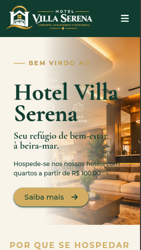
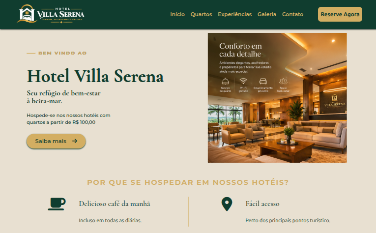

# 🏨 Hotel Villa Serena - Website Responsivo

Website institucional e de reservas para o **Hotel Villa Serena**, desenvolvido como projeto para a **Atividade 4** da UC 13 (Tec_System_Developer). O grande foco desta aplicação é a **responsividade** e a integração do framework **Bootstrap** com um design system customizado de alto padrão.

## 📸 Preview
> 
> | Mobile | Desktop |
> |---|---|
> |  |  |

## 🎯 Sobre o Projeto

O objetivo da atividade era transformar um wireframe de um hotel em uma página web real, responsiva e utilizando Bootstrap. O resultado foi muito além do básico: uma interface de luxo, com paleta de cores baseada em verde-floresta e dourado, imagens harmoniosas e microinterações que elevam a experiência do usuário.

### ✨ Funcionalidades
- **Design Responsivo**: Adaptação fluida para celular, tablet e desktop.
- **Carrossel Inteligente**: No mobile, as imagens do hero rotacionam automaticamente via JavaScript. No desktop, o CSS assume o controle e exibe as imagens em um grid estático lado a lado.
- **Menu Mobile Animado**: O ícone de hambúrguer se transforma suavemente em um "X" (rotação de 180º) ao abrir o menu lateral, e o menu desliza de forma fluida (utilizando `transform` para melhor performance).
- **Rolagem Suave (Smooth Scroll)**: O botão "Reserve Agora" no header leva o usuário suavemente até o formulário no rodapé, fechando o menu mobile automaticamente após o clique.
- **Botão Voltar ao Topo**: Aparece dinamicamente após 20px de rolagem.
- **Validação de Formulário Básica**: Uso de atributos nativos HTML5 (`required`) e interceptação do submit via JavaScript para evitar recarregamento da página, mantendo a integridade do layout.
- **Hack para Autofill**: CSS customizado para impedir que o navegador (Chrome/Safari) deixe o fundo dos inputs branco ao preencher automaticamente com dados salvos.

## 🛠️ Tecnologias e Ferramentas

- **HTML5**: Estruturação semântica e acessível.
- **CSS3**: Aninhamento (Nesting), variáveis (Custom Properties), Flexbox, Grid Layout, `@keyframes` (animações) e `@media` queries.
- **JavaScript (ES6+)**: Modularização via ES Modules, manipulação de DOM e lógica de carrossel/responsividade.
- **Bootstrap 5.3 (CDN)**: Utilizado para o Grid System (`container-fluid`, `row`, `col-*`) e utilitários (`img-fluid`, `h-100`, `user-select-none`).
- **Font Awesome 6 (CDN)**: Ícones vetoriais.
- **Google Fonts**: `Cormorant Garamond` (Títulos elegantes) e `Montserrat` (Texto e UI).

## 📁 Estrutura do Projeto

A arquitetura foi pensada para ser limpa e de fácil manutenção, separando as responsabilidades:

```text
/
├── index.html
├── README.md
└── src/
    └── assets/
        ├── css/
        │   ├── index.css        # Importa todos os módulos CSS
        │   ├── global.css       # Reset, variáveis e hack de autofill
        │   ├── header.css       # Estilos e animações da navbar
        │   ├── main.css         # Hero, seções e carrossel desktop/mobile
        │   ├── footer.css       # Estilos do formulário e rodapé
        │   └── utils.css        # Classes utilitárias e keyframes globais
        ├── js/
        │   ├── index.js         # Ponto de entrada do DOM
        │   ├── initWebSite.js   # Orquestrador (inicia os módulos)
        │   ├── elementsDOM.js   # Mapeamento de todos os elementos HTML
        │   ├── header.js        # Lógica do menu, botão reserva e fixação
        │   ├── main.js          # Lógica do carrossel e botões do conteúdo
        │   └── footer.js        # Lógica de submit do formulário
        └── imgs/                # Assets visuais (logos, banners e quartos)
```

## 🚀 Como Executar

1. Clone o repositório:
   ```bash
   git clone https://github.com/brunotxrs/Hotel-Villa-Serena-Website
   ```
2. Como o projeto utiliza **ES Modules** no JavaScript, ele precisa ser executado através de um servidor local (abrir o `index.html` direto não funcionará para os scripts).
3. Utilize a extensão **Live Server** no VS Code, ou rode:
   ```bash
   npx serve .
   # ou
   python -m http.server
   ```

## 🧠 Decisões Arquiteturais e Aprendizados

1. **CSS Nesting**: Foi utilizada a sintaxe moderna de aninhamento de CSS, deixando os arquivos mais legíveis e próximos da estrutura do HTML.
2. **Bootstrap Customizado**: O framework foi usado como base estrutural, mas as classes utilitárias do projeto foram sobrescritas para manter a identidade visual (ex: `padding: 0 !important` no `<main>` para ocupar a tela inteira).
3. **Hack do `-webkit-autofill`**: O navegador força um fundo amarelo/branco em campos de autofill. Através de `box-shadow` interno e `text-fill-color`, a cor original do projeto foi preservada.
4. **Carrossel Híbrido**: A lógica do JavaScript foi programada para "desistir" em telas maiores que 1024px. Isso permite que o CSS assuma o layout desktop, sem estilos inline do JS quebrando o design.

## 👤 Autor

**Bruno Teixeira**
- GitHub: [@brunotxrs](https://github.com/brunotxrs)

---
*Projeto acadêmico desenvolvido para o Senac EAD.*
